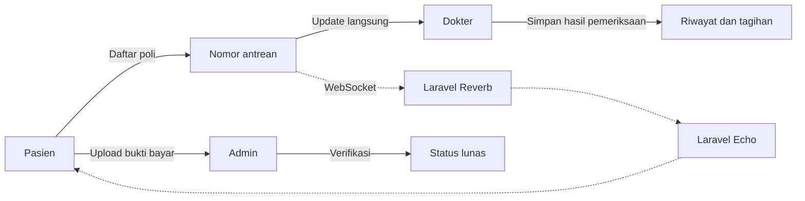

<div align="center">
  
  <h1>Poliklinik Pro</h1>
  <p>Sistem informasi klinik untuk mengelola pendaftaran, antrean, pemeriksaan, dan pembayaran pasien.</p>

  <a href="https://www.php.net/"></a>
  <a href="https://laravel.com/"></a>
  <a href="https://laravel.com/docs/reverb"></a>
  <a href="https://vite.dev/"></a>
</div>

<br>

## Identitas

| | |
|:--|:--|
| **Nama** | Muhammad Daffa Syahdana Haniif |
| **NIM** | A11.2023.15284 |
| **Kelas** | DEV-02 |

## Tentang Proyek

Poliklinik Pro mendukung alur layanan klinik dari pendaftaran sampai pembayaran. Setiap pengguna mendapatkan fitur sesuai perannya.

| Admin | Dokter | Pasien |
|:--|:--|:--|
| Kelola poli, dokter, pasien, dan obat | Kelola jadwal pemeriksaan | Daftar ke poli dan melihat antrean |
| Verifikasi bukti pembayaran | Periksa pasien dan lihat riwayat pasien | Lihat riwayat pendaftaran dan hasil pemeriksaan |
| Ekspor data ke Excel | Ekspor jadwal dan riwayat pasien | Upload bukti pembayaran |
| Terima notifikasi aktivitas pembayaran | Terima notifikasi bukti pembayaran | Terima notifikasi pembayaran lunas |

### Alur Layanan



## Fitur

- **Antrean real-time** dengan Laravel Reverb dan Laravel Echo.
- **Pendaftaran poli** dengan pencegahan antrean aktif ganda.
- **Riwayat pemeriksaan** berisi catatan dokter, obat, dan biaya.
- **Pembayaran** dengan upload bukti, verifikasi admin, dan status lunas.
- **Notifikasi database** untuk upload bukti pembayaran dan konfirmasi lunas.
- **Ekspor Excel** untuk data dokter, pasien, obat, jadwal dokter, dan riwayat pasien.
- **Ganti password mandiri** dengan verifikasi password lama dan penyimpanan hash.

## Teknologi

| Bagian | Teknologi |
|:--|:--|
| Backend | PHP 8.2, Laravel 11 |
| Database | SQLite (konfigurasi awal) |
| Frontend | Blade, Tailwind CSS, Vite |
| Real-time | Laravel Reverb, Laravel Echo, Pusher JS |
| Export | Laravel Excel |

## Menjalankan Secara Lokal

Pastikan PHP 8.2+, Composer, Node.js, dan npm sudah terpasang.

```powershell
git clone https://github.com/haniif17/poliklinik-15284-dev02.git
cd poliklinik-15284-dev02
composer install
npm install
Copy-Item .env.example .env
New-Item -ItemType File -Path database/database.sqlite -Force
php artisan key:generate
php artisan migrate --seed
php artisan storage:link
composer dev
```

Setelah semua service berjalan, buka `http://127.0.0.1:8000`. Perintah `composer dev` menjalankan Laravel, Vite, queue worker, log viewer, dan Reverb.

## Pengujian

```powershell
php artisan test
```

---

<div align="center">
  <sub>Proyek Tugas Bengkel Koding · DEV-02 · A11.2023.15284</sub>
</div>
